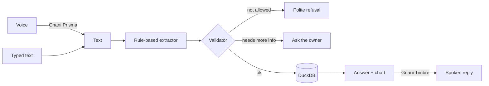

# Voicox

**Ask. Hear. Know.** A voice assistant for kirana (small neighbourhood grocery) shop owners.

Ask a question about your shop in Hindi, Hinglish or English. Voicox works out the answer from your shop's own records and speaks it back in the same language.


-blue)

Built for the Gnani AI Great Indian AI Internship Challenge.

**One-page pitch:** [PITCH.md](PITCH.md)

## Demo

```text
Owner  : "Chawal mein gap kyun hai?"
Voicox : Chawal mein 17 unit kam hai. Sabse pehla sanket: 1 din Chawal ki bikri darj nahi hai (11
         Oct). Agla kadam: Un dinon ki bill book ya billing app dekhiye, aur sales export mein add
         kijiye. Yeh sirf sanket hain, nishkarsh nahi. Pehle records aur stock dobara check kijiye.
```

- Demo video: [Watch on YouTube](https://youtu.be/lSI4mE_Ag9o)

## The problem

Many small shops keep records in notebooks and spreadsheets. When the stock count comes up short, the owner can't tell why: a missed sale, damaged goods, or something else. The records exist, but reading reports takes time that a busy shop owner doesn't have.

Voicox lets the owner just ask.

## Features

- **Speak or type.** Voice questions are turned into text with Gnani Prisma. Replies are spoken with Gnani Timbre.
- **Three languages.** Hindi, Hinglish and English.
- **Exact numbers.** No AI model does the maths or writes the queries. Every figure is calculated from the shop's data using DuckDB.
- **Honest refusals.** If a question is outside what Voicox supports, it says so instead of guessing.
- **Explains stock gaps.** It suggests possible reasons for a shortfall, without blaming anyone.
- **Works without voice.** Typed questions need no API keys.

## How it works



1. **Transcribe.** Speech becomes text (typed questions skip this).
2. **Extract.** Simple rules turn the text into a structured query: what is being asked, which product, which time period.
3. **Validate.** The query is checked against a fixed list of allowed question types. It is accepted, sent back for clarification, or rejected.
4. **Compute.** DuckDB calculates the answer from sales, purchase and inventory data.
5. **Respond.** The answer is worded in the owner's language, shown with a chart or table, and spoken aloud.

**Why no LLM at runtime?** Shop numbers must be exact and repeatable. A language model can guess; a database query can't. So Voicox only uses rules and SQL to answer.

## What you can ask

| Question type | Example |
|---|---|
| Total sales | "Is hafte ki bikri kitni hui?" |
| Top sellers | "Pichle mahine sabse zyada kya bika?" |
| Stock level | "Chawal ka stock kitna hai?" |
| Low stock | "Kaun sa saman kam bach gaya hai?" |
| Stock mismatch | "Stock mein kya mismatch hai?" |
| Why is there a gap | "Chawal mein gap kyun hai?" |

Also supported: sales trends, comparisons between periods or products, and wastage.

**Time periods:** today, yesterday, this week, last week, this month, last month, last 30 days, all time.

**Voicox will not answer:** advice, future predictions, customer information, prices, profit, products the shop doesn't stock, or unsupported time periods.

**How a stock gap is calculated**

```text
Expected stock  = Opening + Purchased - Sold - Damaged
Stock shortfall = Expected stock - Counted stock
```

## Getting started

You need Python 3.10 or newer. Gnani credentials are only needed for voice.

```bash
# 1. Get the code
git clone https://github.com/harshitarathor/Voicox.git
cd Voicox

# 2. Create a virtual environment
python -m venv .venv
source .venv/bin/activate        # Windows: .venv\Scripts\activate

# 3. Install dependencies
pip install -r requirements.txt

# 4. Set up your settings
cp .env.example .env             # Windows: copy .env.example .env
# Open .env and add your Gnani credentials (optional, for voice)

# 5. Start the app
uvicorn backend.main:app --reload
```

Once the app is running, open `http://127.0.0.1:8000` in your browser. The interactive API docs are at `http://127.0.0.1:8000/docs`.

To check that your Gnani credentials work:

```bash
python smoke_test_gnani.py
```

If no credentials are set, the microphone button is hidden and typed questions still work.

> Never commit your `.env` file. It contains your API keys.

## Try the API

```bash
curl -X POST http://127.0.0.1:8000/ask \
  -H "Content-Type: application/json" \
  -d '{"text": "Chawal ka stock kitna hai", "lang": "hn"}'
```

`lang` can be `en`, `hi` or `hn` (Hinglish, the default).

## Project layout

```text
Voicox/
├── backend/
│   ├── data/               Synthetic shop data and the script that generates it
│   ├── config.py           Settings and environment variables
│   ├── engine.py           DuckDB query engine
│   ├── extractor.py        Rule-based question extractor
│   ├── gnani.py            Gnani Prisma / Timbre client
│   ├── insights.py         Stock-gap explanations
│   ├── main.py             FastAPI app and routes
│   ├── phrases.py          Reply wording for each language
│   ├── pipeline.py         Loads and cleans the raw CSV data
│   ├── schemas.py          Request and query schemas
│   └── validator.py        Allowed question types, refusals, clarifications
├── frontend/
│   ├── assets/             Images
│   ├── css/                Styles
│   ├── js/
│   │   ├── pages/          Ask, Sales, Stock, Detective, Data and Reliability screens
│   │   ├── vendor/         Third-party libraries (Plotly)
│   │   ├── answer.js       Answer card
│   │   ├── app.js          Navigation and start-up
│   │   ├── core.js         Shared helpers and charts
│   │   ├── i18n.js         Language strings
│   │   ├── registry.js     Page registry
│   │   └── voice.js        Microphone and playback
│   └── index.html
├── benchmark/
│   ├── audio/              Recorded test questions
│   ├── questions.csv       The 30 test questions
│   ├── record_audio.py     Records the audio samples
│   ├── run_benchmark.py    Scoring script
│   ├── results.json
│   ├── results.md          Per-question results
│   └── transcripts.json
├── tests/                  pytest suite
├── PITCH.md                One-page solution pitch
├── smoke_test_gnani.py     Checks your Gnani credentials
├── .env.example
├── pytest.ini
└── requirements.txt
```

## Testing

```bash
pytest
```

The tests cover refusals, unknown products, unsupported periods and the benchmark scoring code. They don't call Gnani, so they use no credits.

## Benchmark

30 questions (20 spoken, 10 typed) across Hinglish, Hindi, English and noisy audio. Each answer is checked against a figure calculated directly from the raw CSV files, not from the app's own engine.

| Group | Result |
|---|---|
| Hinglish | 100% |
| Hindi | 100% |
| Noisy audio | 100% |
| English | 60% (3 of 5) |
| **Overall** | **28 of 30 (93%)** |

Both misses were English phrases that the speech recogniser misheard. Results are on synthetic shop data.

Each question is scored on three checks:

- **speech:** the transcript is at least 80% similar to what was said (recorded audio only)
- **query:** the app produced the right intent, metric, period and product
- **answer:** the number or list matches the independently calculated figure

Full per-question results: [benchmark/results.md](benchmark/results.md)

To re-run it:

```bash
python benchmark/run_benchmark.py              # use recorded audio
python benchmark/run_benchmark.py --text-only  # typed questions only (free)
```

## Limitations

- This is a prototype that uses synthetic demo data. It has not been tested on real shop records.
- It is not hosted publicly, because a public demo would expose the Gnani API key. Login and usage limits would be needed first.
- Questions are matched using rules, so unusual phrasing may be refused or ask for clarification.
- English speech recognition scored lowest in the benchmark.

## Roadmap

- [ ] Test with real shop records
- [ ] Add more Indian languages
- [ ] Host a version with login and usage limits
- [ ] Connect real billing, purchase and credit records
- [ ] Run tests automatically on every push (GitHub Actions)

## Extending Voicox

**Add a language:** add a phrase set in `backend/phrases.py`, register the language code, then add benchmark questions for it.

**Add a question type:** add the intent to the schema and validator whitelist, write the extraction rules in `backend/extractor.py`, implement the query and its wording, then add tests.

## Acknowledgements

- [Gnani.ai](https://www.gnani.ai) for Prisma (speech-to-text) and Timbre (text-to-speech)
- Built with assistance from [Claude](https://www.anthropic.com/claude) by Anthropic

---

Made by [Harshita Rathor](https://github.com/harshitarathor)
